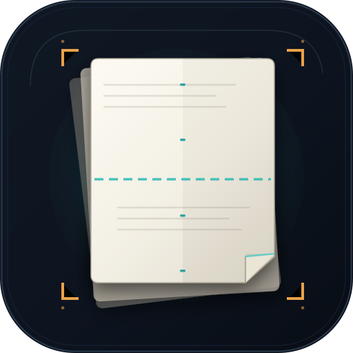
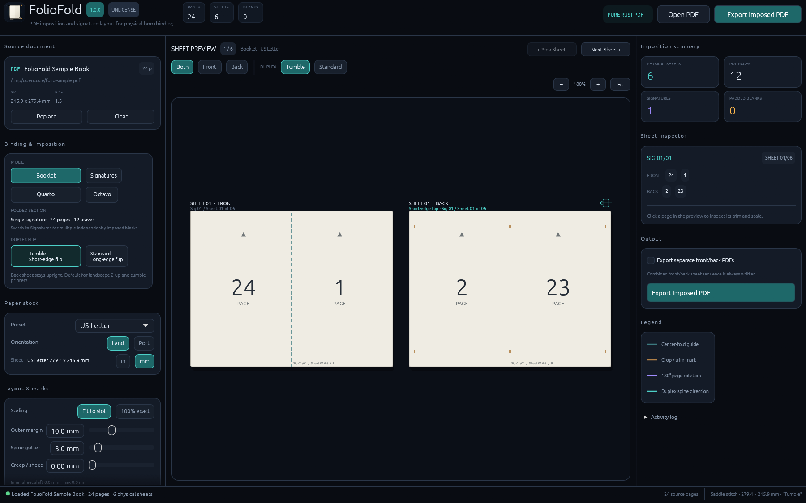

# FolioFold

<p align="center"></p>

**FolioFold** is a native, cross-platform PDF imposition studio for physical bookbinding. Drop in a normal reading-order PDF, choose a fold scheme, tune paper, margins, creep, and printer marks, then export a duplex-ready sheet sequence where every page lands where the binder expects it.

Built in pure Rust with `eframe` / `egui` and `lopdf`. Source pages are embedded as Form XObjects rather than rasterized: text stays text, fonts stay embedded, vector artwork stays vector, and images are copied losslessly. No external PDF tools are used.

[GitHub repository and releases](https://github.com/asdw2747/folio-fold)



*Booklet mode with front/back physical-sheet preview, fold guides, trim marks, duplex flip indicator, and live signature/sheet counts.*

## Features

### Imposition modes

- **Booklet / saddle stitch** — one nested signature, 2-up duplex, padded to a multiple of four pages.
- **Multi-signature signatures** — Smyth-sewn or casebound blocks from `2` to `16` leaves (`4–32` pages), with 14 leaves / 28 pages included as a standard preset and custom even-leaf sizes up to 32 leaves / 64 pages. Each signature is imposed independently, and the final signature is padded with blank flyleaves.
- **Quarto** — 4 pages per sheet side, 2×2 grid, top row rotated 180° head-to-head, folded twice.
- **Octavo** — 8 pages per sheet side, 4×2 grid, top row rotated 180° head-to-head, folded three times.

### Real binder geometry

- Paper presets: US Letter, US Legal, US Tabloid, A4, A3, A5, B5.
- Landscape/portrait orientation and custom width × height in millimetres or inches.
- Fit-to-slot scaling with preserved aspect ratio, or 100% exact placement.
- Adjustable outer margins and inner spine gutter.
- Progressive creep compensation from `0.00` to `0.50 mm` per folded sheet, nudging inner folios toward the spine.
- Optional center-fold dashed lines, corner crop/trim marks, and subtle signature/sheet sequence labels (`Sig 01 / Sheet 02`).

### Duplex orientation

- **Tumble / short-edge** — back-side pages stay in their logical orientation. Recommended default for landscape 2-up.
- **Standard / long-edge** — every back-side page is additionally rotated 180° so common long-edge duplex printers stay registered.
- A duplex flip glyph in the preview shows which edge the sheet is turned over on.

### Interactive preview

- Drag-and-drop PDF loading, plus an **Open PDF** dialog and optional startup path.
- Source page count, source page dimensions, PDF version, signature count, physical-sheet count, and padded blank count.
- Front and back sheets side by side, or a single-side view.
- Signature jump selector and `‹ Prev Sheet` / `Next Sheet ›` navigation.
- Exact page numbers, blank flyleaf markers, 180° rotation badges, orientation arrows, fold lines, trim boxes, and crop marks.
- Click a page to inspect its trim size, scale, rotation, and creep shift.
- Wheel zoom, drag-to-pan, and Fit reset.

### Output

- One-click vector **Export Imposed PDF**, with a cancellable build and atomic file replacement.
- Optional additional `<name>-fronts.pdf` and `<name>-backs.pdf` files for manual single-sided duplex printing.
- One output PDF page per physical sheet side, ordered front/back, front/back.
- Full sheet MediaBox, standard Helvetica sequence micro-labels, and no rasterization.

## Page-order matrices

### Nested 2-up signatures

For a signature of `N` pages and sheet index `j` (zero-based):

```text
Front: [N - 2j, 1 + 2j]
Back:  [2 + 2j, N - 1 - 2j]
```

An eight-page signature produces:

```text
Sheet 1 front: 8 | 1      Sheet 1 back: 2 | 7
Sheet 2 front: 6 | 3      Sheet 2 back: 4 | 5
```

Multi-signature mode applies the same formula independently inside each consecutive block. Page numbers in the preview and output are absolute book pages; blanks beyond the source page count are flyleaves.

### Quarto (4 pages per side)

`↻` means 180° rotation.

```text
Front                 Back
5↻     4↻             3↻     6↻
8      1              2      7
```

Each physical sheet carries 8 book pages. A final quarto sheet is padded to 8 pages.

### Octavo (8 pages per side)

```text
Front                                   Back
5↻   12↻    9↻    8↻                     7↻   10↻   11↻    6↻
4    13     16     1                     2    15    14     3
```

Each physical sheet carries 16 book pages. A final octavo sheet is padded to 16 pages.

## Build

### Requirements

- Rust 1.88 or newer.
- Linux: an X11 or Wayland session with OpenGL (XWayland works).
- Windows: MSVC target; the repository enables static CRT linking so the executable runs without the VC++ Redistributable.
- No external PDF utilities are required at runtime.

### Linux release

```bash
cargo build --release
./target/release/folio-fold
```

### Linux AppImage

Install `appimagetool`, then build the AppImage from the release binary:

```bash
cargo build --release
./scripts/build-appimage.sh
```

The result is:

```text
dist/FolioFold-1.0.0-x86_64.AppImage
```

The AppImage bundles the executable, desktop entry, application icon, license, third-party notices, and license texts. It requires a Linux system with X11 or Wayland plus OpenGL, and the glibc version of the build host.

### Static-CRT Windows x86_64 cross-build

`.cargo/config.toml` contains:

```toml
[target.x86_64-pc-windows-msvc]
rustflags = ["-C", "target-feature=+crt-static"]
```

Install the target and `cargo-xwin`, then build:

```bash
rustup target add x86_64-pc-windows-msvc
cargo install cargo-xwin
cargo xwin build --release --target x86_64-pc-windows-msvc
```

The executable is written to:

```text
target/x86_64-pc-windows-msvc/release/folio-fold.exe
```

The Windows build embeds the FolioFold application icon and version metadata as a PE resource via `winresource`. On Linux that requires `llvm-rc` on `PATH` (normally installed with LLVM); on Windows it uses the Windows SDK `rc.exe`.

## Usage

1. Drop a PDF onto the window or press **Open PDF**.
2. Pick a binding mode. `Booklet` and `Signatures` use 2-up duplex; `Quarto` and `Octavo` use folded-sheet grids.
3. For **Signatures** mode, set **Leaves / signature** (for example, `8 leaves · 16 pages`). Presets run from 2 to 16 leaves; choose **Custom…** for other even leaf counts up to 32 leaves. Booklet mode always uses one signature.
4. Choose the paper stock and orientation. Custom width/height can be entered in mm or inches.
5. Choose **Fit to slot** for safe margins or **100% exact** for original-size placement.
6. Set the outer margin, spine gutter, and creep. Creep applies to nested 2-up signatures.
7. Choose **Tumble** for short-edge duplex or **Standard** for long-edge duplex.
8. Navigate the sheet preview and click pages to verify order, rotation, trim size, and creep.
9. Press **Export Imposed PDF**. Optionally enable separate front/back files.

### Print check

Always print one test sheet before a full run. Hold it up to a light to verify front/back registration, then fold and trim a blank mock-up. Printer duplex settings and paper feed orientation vary by model; the preview tells you what FolioFold has written, not what your printer driver will do with it.

## Development utilities

Generate a vector sample PDF and exercise the engine without the GUI:

```bash
cargo run --example make_sample -- sample.pdf 24
cargo run --example impose -- sample.pdf imposed.pdf booklet short
cargo run --example impose -- sample.pdf imposed.pdf octavo long
```

## Verification

```bash
cargo fmt --check
cargo clippy --all-targets -- -D warnings
cargo test
cargo build --release
cargo xwin build --release --target x86_64-pc-windows-msvc
```

The test suite covers:

- saddle-stitch page order for 4, 8, and padded booklets
- multi-signature blocks at 8 and 16 pages, including absolute page offsets, leaf/page conversions, 14-leaf presets, custom 36-page signatures, and blank padding
- quarto and octavo page coverage and head-to-head rotation matrices
- duplex short-/long-edge rotation composition
- progressive creep direction and per-sheet shift math
- paper presets, orientation swapping, mm/in conversion, fit vs exact scaling
- exact-scale overflow warnings across Booklet, Signatures, Quarto, and Octavo
- 0/90/180/270 source-page normalization matrices
- CropBox offsets, UserUnit scaling, mixed page sizes, and inherited page-tree attributes
- placement matrices for upright and 180° page content
- end-to-end synthetic PDF imposition through `lopdf`, verifying valid output structure, exact output page counts, Form XObject preservation, image XObject preservation, page-label coverage, source-change warnings, cancellation, and separate front/back files

## Notes and limitations

- Encrypted PDFs must have their password protection removed before imposition.
- Source pages are cropped to their CropBox when present, otherwise their MediaBox. Source `/BleedBox` and `/TrimBox` are not preserved.
- Annotations, links, form fields, page-level optional-content state, and catalog `/OCProperties` are not imposed; only page content and its resource graph are embedded.
- Catalog `/OutputIntents` and ICC output intents are not copied. Embedded image, font, and colour-space resources retain their own profiles.
- The output sheets have a full-sheet MediaBox and printed crop marks, not individual per-page `/TrimBox` entries.
- The preview is a structural page-number preview, not a rasterized content thumbnail. The exported PDF contains the original vector page content.
- Quarto and Octavo treat each physical sheet as an independent 8- or 16-page section. Multiple sections are not nested into a larger signature.
- `100% exact` can overflow a slot intentionally; FolioFold displays a warning in the layout panel and export report. Choose **Fit to slot** for a guaranteed fit.
- If the source PDF changes after loading, FolioFold warns in the export report. Reload it to refresh the preview.
- Export output is written through a temporary file and atomically replaced on success. Cancelling stops between sheet sides and does not leave a partially written file.

## License

FolioFold is released into the public domain under the [Unlicense](LICENSE). See [THIRD_PARTY_NOTICES.md](THIRD_PARTY_NOTICES.md) for Rust crates, embedded font licenses, and full third-party license texts in [`LICENSES/`](LICENSES/).
